# Contacts

← [Back to Overview](./overview.md)

Your contacts are the people who can receive incidents. You can manage them manually, import them from a CSV file, or keep them in sync automatically by [connecting an HR system](#integrations).

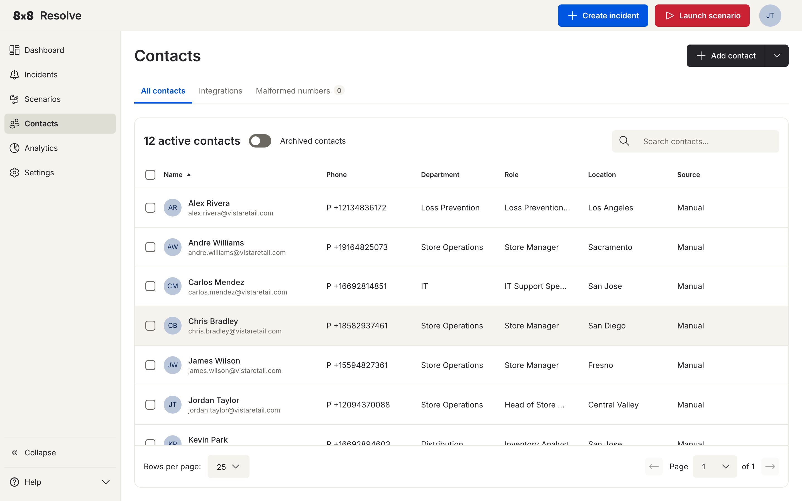

## View your contacts

Navigate to **Contacts** from the left menu. The **All contacts** tab opens by default and shows your full contact list; the **Integrations** tab is where you [connect a directory or HR system](#integrations), and the **Malformed numbers** tab lists contacts whose phone numbers need [fixing](#fix-malformed-phone-numbers).

The number of active contacts is shown above the table, for example *12 active contacts*. Turn on **Archived contacts** next to it to see the contacts you've archived instead (see [Archive contacts](#archive-contacts)). The table has these columns:

| Column | Description |
| --- | --- |
| **Name** | The contact's full name, with their email address underneath. |
| **Phone** | Their phone numbers: **P** marks the personal number and **W** the work number. Shows "-" if neither is set. |
| **Department** | The contact's department. |
| **Role** | The contact's role or job title. |
| **Location** | The contact's office or site. |
| **Source** | Where the contact came from, for example **Manual** (added by hand or from a CSV file) or an integration such as Google Workspace. |

Click a column heading, such as **Name**, **Department**, **Role**, or **Location**, to sort by it. Use **Rows per page** and the page controls at the bottom of the table to move through a long list.

## Search and filter

- **Search** — Type in **Search contacts...** to filter the list as you type.
- **Filters** — Click the filter icon next to the search box and choose values for contact attributes, such as department, role, or location. Click **Apply** to filter the list, or **Reset** to clear the filters.

You can combine the search box with filters.

## Add a contact manually

1. Click **Add contact**.
2. Fill in the contact's details: **First name**, **Last name**, **Email**, **Work phone**, **Personal phone**, **Role**, **Department**, and **Location**. No single field is required, but you need to fill in at least one.
3. Click **Add contact**. The contact appears in the list immediately.

## Upload contacts from a CSV

1. Click the dropdown arrow next to **Add contact**.
2. Select **Upload contacts**.
3. Choose your CSV file and start the upload. A progress bar shows you how the import is going.

The CSV file must be UTF-8 encoded, no larger than 10 MB, and contain no more than 50,000 rows. Enter phone numbers in international format with the country code (for example, `+12094370088`). Numbers without a country code are treated as US numbers. If a number isn't valid that way either, the contact is listed on the [Malformed numbers](#fix-malformed-phone-numbers) tab.

To start from the right columns, click **Download CSV Template** in the upload dialog.

### Replace your contacts with a CSV file

By default, an upload adds new contacts and updates the ones already in Resolve. To make the file your complete contact list instead, select **Overwrite existing contacts** before you click **Upload**:

- Contacts in the file are added or updated.
- Every contact you added manually or from an earlier CSV file that isn't in the file is archived. Archived contacts can't be chosen as recipients, and you can restore them from [Archived contacts](#view-and-restore-archived-contacts).

Resolve asks you to confirm. Click **Overwrite contacts** to go ahead.

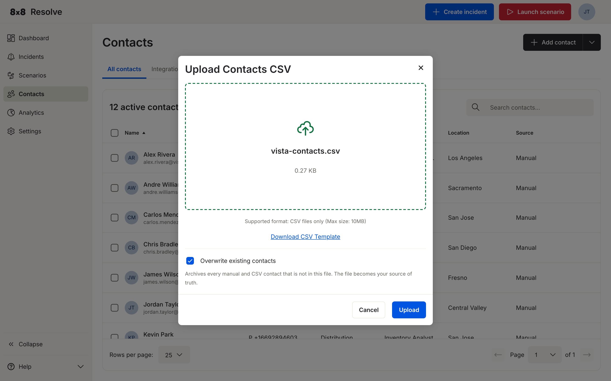

> 📘 **Only without an integration**
>
> **Overwrite existing contacts** appears only when no directory or HR system is connected, including 8x8 Contacts. Contacts that come from an integration are never archived by a CSV upload.

## Fix malformed phone numbers

Resolve stores phone numbers in international format, with the country code, so it can send SMS, voice, and WhatsApp alerts. When a contact's number can't be read that way, usually because it's a local number without a country code from a CSV file or an integration, the contact is listed on the **Malformed numbers** tab. The tab shows how many contacts need attention, and their numbers are shown in red.

To fix them, tell Resolve which country the numbers belong to:

1. Go to **Contacts** → **Malformed numbers**.
2. Select the contacts whose numbers are from the same country. To select every contact on the tab, select **Select all *N* malformed**.
3. Under **Select region**, choose the country, for example **United Kingdom (GB)**.
4. Click **Normalize**.

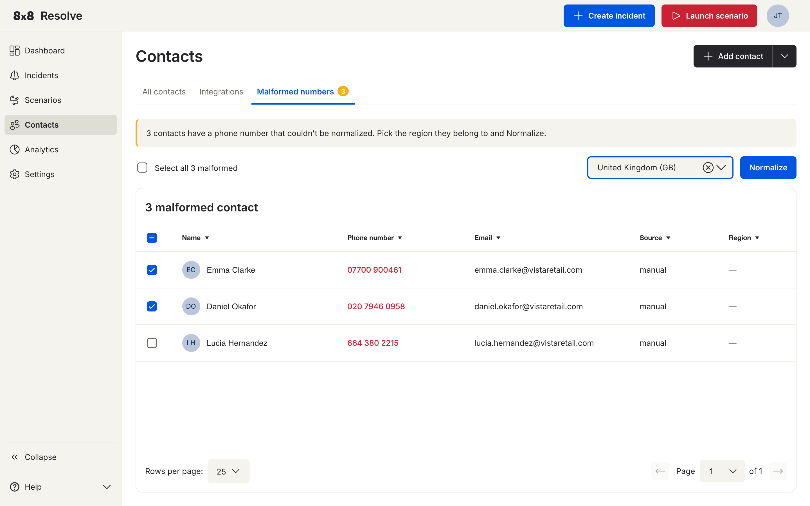

Normalizing runs in the background, and Resolve shows how many numbers it fixed, for example *Normalized 1 of 2 number(s)*. Then:

- Contacts whose numbers are valid for that country leave the list. Resolve keeps the number as it was entered and uses the international version for alerts. For example, `020 7946 0958` with **United Kingdom (GB)** becomes `+442079460958`.
- A number that still isn't valid for that country stays on the list, with the country shown in the **Region** column. This is also what usually happens if you choose the wrong country. Check the number at its source, such as the CSV file or your directory, and correct it there.

Resolve remembers the country you chose for each contact, so later syncs from an integration fix that contact's number automatically.

## Edit a contact

Click a contact's row to open **Edit contact**. Each field shows where its value came from, such as **(Manual)** or the logo of the integration that synced it. Change the details and click **Save changes**. To remove the contact from your list, click **Archive** (see [Archive contacts](#archive-contacts)).

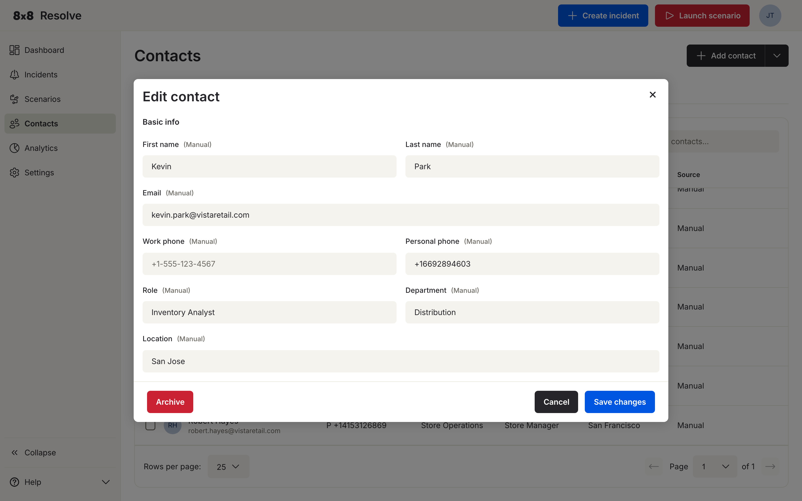

> 📘 **Synced contacts are read-only**
>
> You can edit contacts that you added manually or uploaded from a CSV file. Contacts that come from an integration are read-only in Resolve: **Edit contact** shows that the contact is managed by an external source. Update them in the source system and they change in Resolve at the next sync. You can still archive a synced contact.

## Archive contacts

Archive contacts who shouldn't receive alerts any more, such as people who have left or seasonal staff. Archived contacts disappear from **All contacts** and can't be chosen as recipients, but Resolve keeps their details and history, so you can restore them later. You can archive contacts from any source: added manually, uploaded from a CSV file, or synced from an integration.

**Archive one contact:** click the contact's row, click **Archive** in **Edit contact**, and confirm.

**Archive several contacts:**

1. Select the checkboxes next to the contacts. To select every contact on the page, select the checkbox in the header.
2. To include contacts on other pages too, click **Select all *N* contacts** in the banner that appears. This selects every contact that matches your current search and filters, not just the ones on the page.
3. Click **Archive** and confirm.

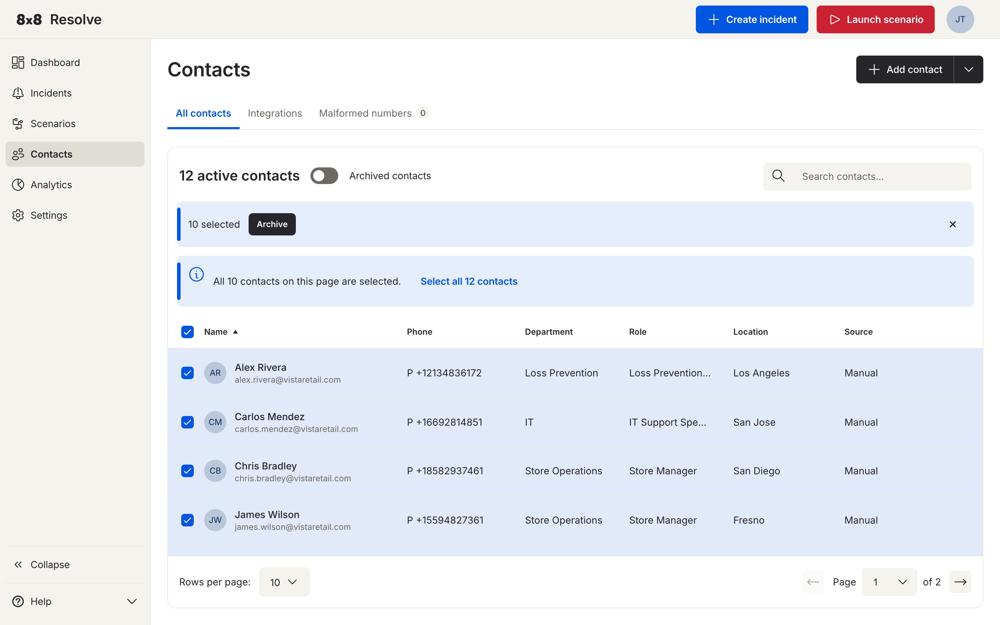

You can select up to 500 contacts at a time; to archive more, use **Select all**. Archiving runs in the background, and the list updates when it finishes. You can run one archive or restore at a time.

> 📘 **Archiving synced contacts**
>
> When you archive a contact that comes from an integration, Resolve also stops syncing that person, so the next sync doesn't bring them back. Restoring the contact turns syncing back on.

### View and restore archived contacts

1. Turn on **Archived contacts** above the table. The table lists your archived contacts, and the count above it shows how many there are.
2. Select the contacts you want back, or select all of them.
3. Click **Restore contact** (or **Restore contacts**) and confirm.

Restored contacts reappear in **All contacts**, and contacts from an integration start syncing again.

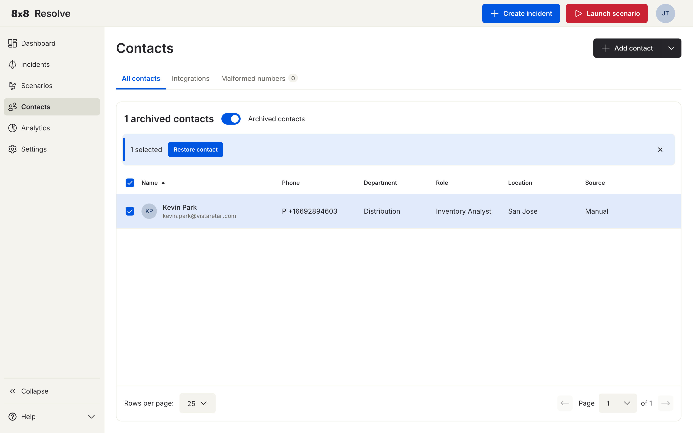

Contacts that an integration archived because their account was disabled in the source system can't be restored by hand. They come back automatically at the next sync after the account is enabled again.

## Integrations

Connect 8x8 Contacts or your directory or HR system to 8x8 Resolve from the **Integrations** tab and your contacts stay in sync automatically. When an employee's department, location, or phone number changes in the source system, Resolve picks it up — so your incident targeting is always accurate.

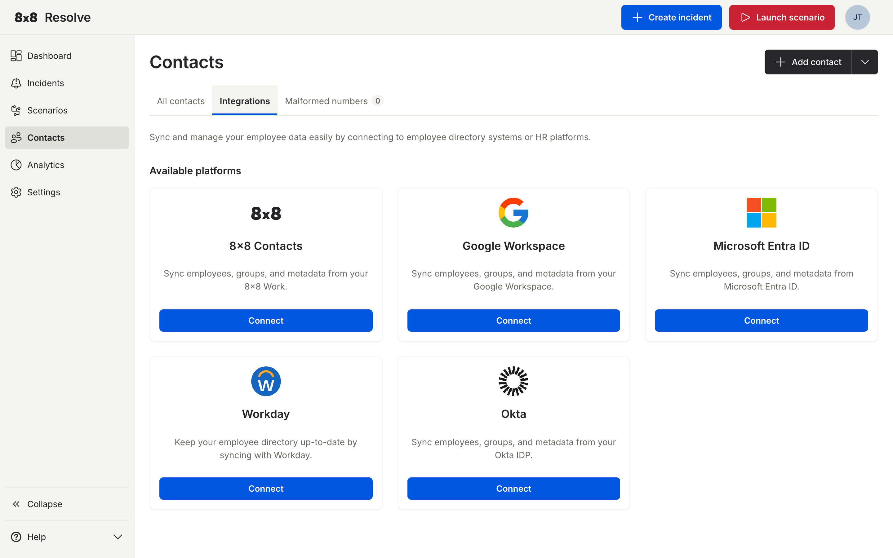

Each sync maps the contact's **Name, Email, Phone, Department, Location, and Group**. Connections use secure API authentication (OAuth 2.0), data is isolated per tenant so it's never shared between 8x8 customers, and failed syncs are logged and retried automatically.

Supported sources:

- **8x8 Contacts** — employees, groups, and metadata from your 8x8 Work account.
- [Google Workspace](#google-workspace)
- [Microsoft Entra ID](#microsoft-entra-id) (Azure Active Directory)
- [Workday](#workday)
- [Okta](#okta)

### Connect an integration

To start, go to **Contacts** → **Integrations**, find your system under **Available platforms**, and click **Connect**. A wizard opens with four steps: **Connect**, **Sync filters**, **Map fields**, and **Done**. The screenshots below show Microsoft Entra ID; the steps are the same for every system.

#### Step 1: Connect

Read **Before you start**: it lists what to set up in your system first, such as the permissions to grant. Then enter the credentials for your system (see [Google Workspace](#google-workspace), [Microsoft Entra ID](#microsoft-entra-id), [Okta](#okta), or [Workday](#workday) below) and click **Test connection**. When **Connection successful** appears, click **Next: Sync filters**.

For **8x8 Contacts**, there's nothing to enter: the step shows the 8x8 tenant your account is linked to and which details are synced (names, roles, departments, locations, and phone numbers). Click **Test connection**, then **Next: Sync filters**.

Credentials are stored encrypted and are never shown again after you save them.

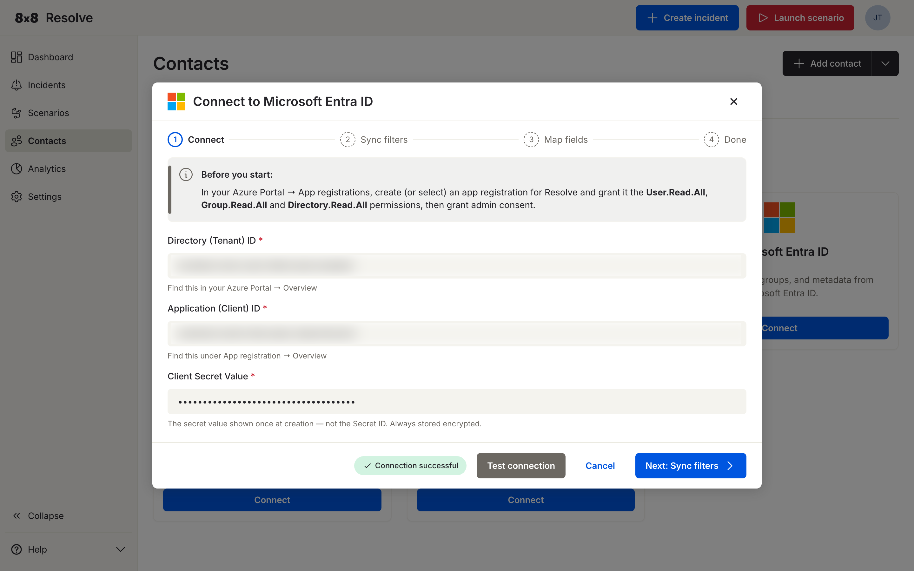

#### Step 2: Sync filters

Choose which people are synced. Without filters, everyone in your directory is synced.

1. Click **Add filter rules**.
2. Choose a field from your directory, such as **Department**, **Office Location**, or **Account Enabled**, then an operator, then type a value. The operators are **equals**, **not equals**, **starts with**, **ends with**, **contains**, **is null**, and **is not null**.
3. To narrow the list, click **+ AND** to add another rule to the group: a person must match every rule in the group. To widen it, click **+ OR** to add another group: a person can match any group.

As you build the rules, the step shows roughly how many contacts match (for example, *~12 contacts matched*) and a sample of matching people, so you can check the result before you go on. For Microsoft Entra ID, the filter runs in Microsoft Graph, so data about people you exclude never leaves your directory. Click **Next: Map fields**.

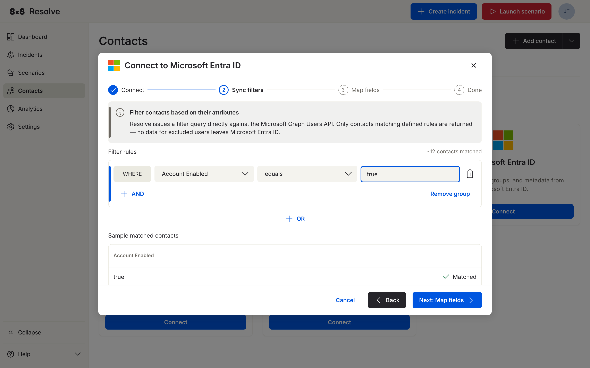

#### Step 3: Map fields

Tell Resolve which field in your directory fills each contact field. Click **Add mapping**, choose the field in your system on the left and the Resolve field on the right, and repeat for each field:

| Resolve field | Example source field (Microsoft Entra ID) |
| --- | --- |
| **Personal phone** (required) | Mobile Phone |
| **Work phone** | Business Phone |
| **Email** | Mail |
| **First Name** / **Last Name** | First Name / Last Name |
| **Role** | Job Title |
| **Department** | Department |
| **Location** | Office Location |
| **Custom property** | Any other field. Enter a name for the property. |

Each field can be mapped only once. You must map **Personal phone** before you can continue, because Resolve uses it for SMS and voice alerts. To remove a mapping, click its trash icon. Click **Save & continue**.

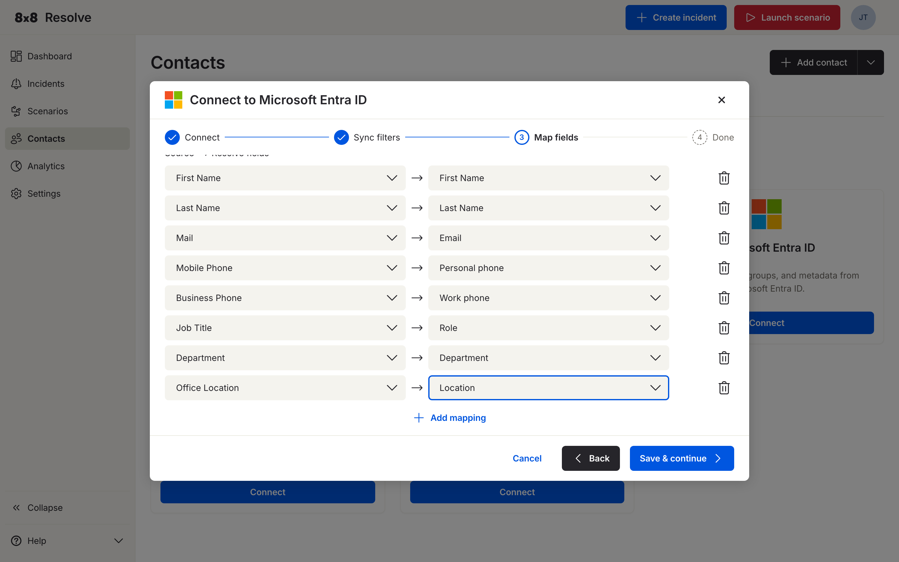

#### Step 4: Done

Review the summary: **Credentials** (**Verified**), **Sync frequency** (**Every 24 hours**), **Sync filters** with the number of matched contacts, and **Field mapping**. Click **Activate integration**. The integration appears in your connected platforms and the first sync starts shortly afterwards.

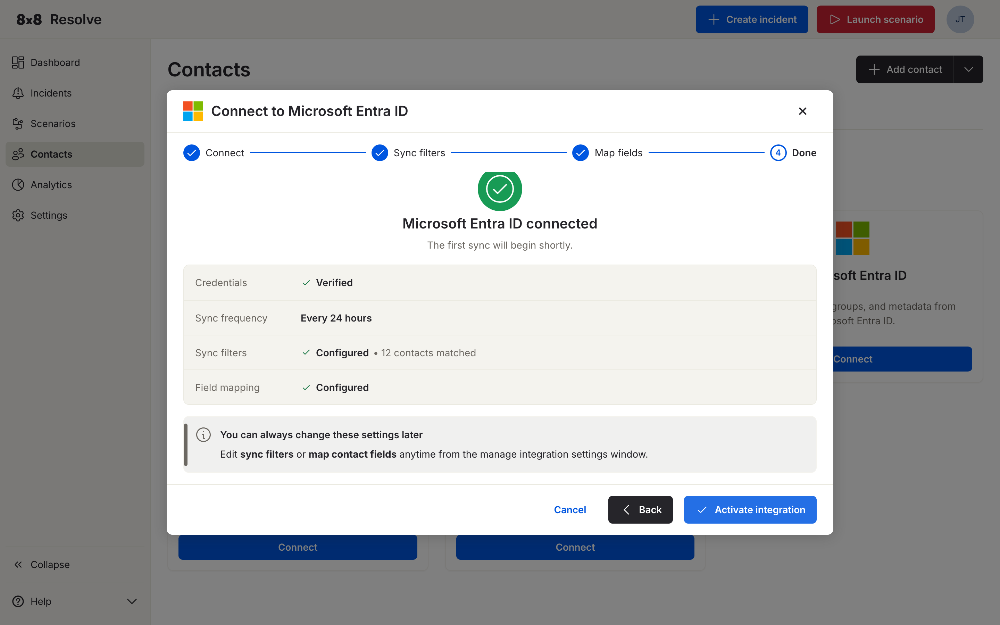

You can change the sync filters and field mappings later: click **Manage** on the integration. From there you can also view sync history and start a sync straight away.

### Target contact groups

Employee groups from your source system (for example, "Engineering Team" or "US-Based Employees") sync across automatically and appear as named groups in the **Recipients** selector when you create an [incident](./incidents.md) or [scenario](./scenarios.md). There's no manual setup — when someone changes department or location in the source system, the matching group updates automatically, so your targeting stays accurate.

### Sync history

Every time Resolve syncs with your HR system, it logs the result here:

| Column | Description |
| --- | --- |
| **Job ID** | Unique identifier for the sync run. |
| **Status** | Whether the job succeeded or failed. |
| **Total Contacts** | Number of contacts found in the source. |
| **Synced** | Contacts successfully imported or updated. |
| **Started At** | When the job began. |
| **Finished** | When the job completed. |
| **Expand (∨ / ∧)** | Click to see a per-job breakdown: **Added**, **Updated**, and **Deleted** counts. An **Export .csv** button downloads the full details of that sync job. |

Click **Sync now** in the integration panel to trigger an immediate sync outside the daily schedule.

### Remove an integration

In the **Manage** panel, click **Remove integration** and confirm. The contacts that the integration imported are removed from your contact list. Contacts you added manually or uploaded from a CSV file aren't affected.

When a person is removed from your source system, Resolve archives their contact at the next sync rather than deleting it, so past incident records stay complete.

---

### Google Workspace

**You'll need:**

| Credential | Description |
| --- | --- |
| **Service Account Email** | The email address of the Google service account. |
| **Credentials JSON** | A JSON credentials file for the service account, with delegated Domain Wide Authority. |

**How to set it up:**

1. Follow Google's [Domain Wide Delegation of Authority](https://developers.google.com/admin-sdk/directory/v1/guides/delegation) guide to create a service account. You'll need a Google Workspace administrator to do this.
2. Grant the service account the following OAuth scopes:
   - `https://www.googleapis.com/auth/admin.directory.user.readonly`
   - `https://www.googleapis.com/auth/admin.directory.group.readonly`
   - `https://www.googleapis.com/auth/admin.directory.orgunit.readonly`
3. Download the JSON credentials file.
4. Enter the service account email and paste the JSON into the Resolve integration form.

---

### Microsoft Entra ID

**You'll need:**

| Credential | Description |
| --- | --- |
| **Directory (Tenant) ID** | The tenant ID of the account that will read your user directory. |
| **Application (Client) ID** | The client ID of your registered application. |
| **Client Secret Value** | The value of your registered application's client secret. |

**How to set it up:**

1. [Register an application](https://learn.microsoft.com/en-us/entra/identity-platform/quickstart-register-app) in Microsoft Entra ID.
2. Create a client secret under **Certificates and Secrets**.
3. Grant the following API permissions under your registered app (all Application type):

   | Permission | Type | Requirement |
   | --- | --- | --- |
   | `User.Read.All` | Application | Admin approval required |
   | `Group.Read.All` | Application | Admin approval required |
   | `Directory.Read.All` | Application | Admin approval required |

4. Copy the Directory (Tenant) ID, the Application (Client) ID, and the client secret's value into the Resolve integration form. Use the secret's **Value**, which Microsoft shows only once when you create it, not its **Secret ID**.

> 🚧 **Client secret expiry**
>
> Client secrets expire based on the duration you set when creating them. Update the secret in Resolve before it expires — expired credentials will cause sync jobs to fail.

---

### Okta

**You'll need:**

| Credential | Description |
| --- | --- |
| **Domain** | Your Okta organisation domain — the `MY_DOMAIN` part of `https://MY_DOMAIN.okta.com/`. |
| **API Token** | A personal API token with at least the Read-Only Administrator role. |

**How to set it up:**

1. Follow Okta's guide to [create a personal API token](https://help.okta.com/en-us/content/topics/security/api.htm?cshid=ext-create-api-token#create-okta-api-token).
2. Assign the token a **Read-Only Administrator** role at minimum.
3. Enter your domain and API token into the Resolve integration form.

> 🚧 **API token expiry**
>
> Depending on your Okta configuration, API tokens may expire. Update the token in Resolve before it expires to avoid sync failures.

---

### Workday

**You'll need:**

| Credential | Description |
| --- | --- |
| **Report URL** | The URL to your Workday RaaS (Report as a Service) report, in JSON format. |
| **Username** | Username of the account with access to the report. |
| **Password** | Password of that account. |

**How to set it up:**

1. Create a Custom Report in Workday that outputs employee contact data.
2. Get the report URL in JSON format — it will look something like:
   `https://wd5-impl-services1.workday.com/ccx/service/customreport2/your_org/report_name?format=json`
3. Enter the report URL, username, and password into the Resolve integration form.

**Required report format:**

Your Workday report must return data in this exact structure. Key names must match exactly — including capitalisation.

```json
{
  "Report_Entry": [
    {
      "Contact_Number": "+1 411 111 1111",
      "Department": "Sales",
      "Email_Address": "johnsmith@email.com",
      "First_Name": "John",
      "Job_Title": "Product Manager",
      "Last_Name": "Smith"
    }
  ]
}
```

---

### Integration security

> 📘 **Recommended: use a dedicated read-only account**
>
> For each integration, we recommend creating a dedicated service account with read-only access. This limits the blast radius if credentials are ever compromised.
>
> All credentials you enter are stored encrypted. Sensitive values are never returned in plain text — even users with admin access cannot view them after they've been saved.
