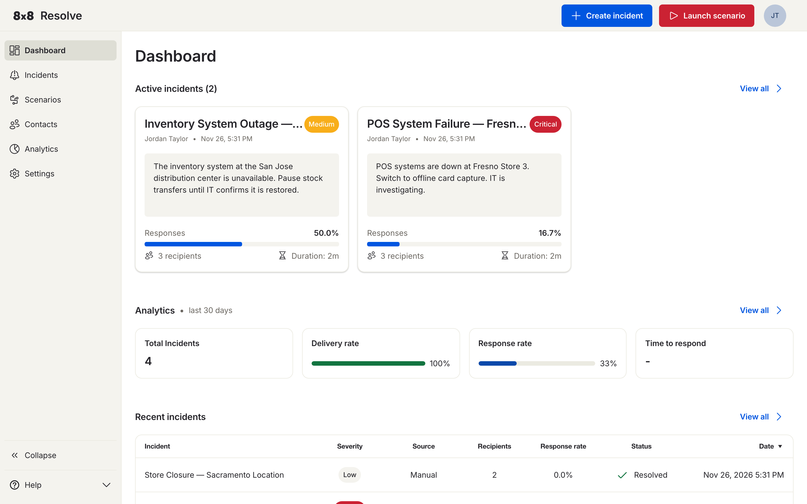

# Dashboard

← [Back to Overview](./overview.md)

The dashboard is the first thing you see after you log in. It gives you a live summary of active incidents and a 30-day snapshot of your alert performance.

## Active incidents

The top section (**Active incidents**) shows a card for each incident that's still active. Each card tells you:

- **Title** and **severity** (Critical, Medium, or Low)
- Who launched the incident, and when
- A preview of the message that was sent
- **Responses** — the percentage of recipients who responded so far. If the incident didn't ask for a response, the card shows **Delivered** instead.
- Number of recipients targeted
- **Duration** — how long the incident has been active

Click any card to open the incident details page.

## Analytics

Below the incident cards, the **Analytics · last 30 days** section summarises recent performance:

| Metric | What it measures |
| --- | --- |
| **Total Incidents** | Number of incidents sent in the last 30 days. |
| **Delivery rate** | Percentage of sent messages successfully delivered to recipients. |
| **Response rate** | Percentage of recipients who responded. |
| **Time to respond** | Average time between sending an incident and a recipient responding. |

For trends, channel effectiveness, and per-incident breakdowns over any period, see the [Analytics](./analytics.md) page.

## Recent incidents table

Scroll to the bottom of the dashboard to find the **Recent incidents** table — your most recent incidents at a glance, without navigating to the full Incidents page. It shows these columns:

| Column | Description |
| --- | --- |
| **Incident** | The incident title. |
| **Severity** | Critical, Medium, or Low. |
| **Source** | How the incident was created, for example **Manual** for an incident created from the **Create incident** panel. |
| **Recipients** | Number of people targeted. |
| **Response rate** | Percentage of recipients who responded. |
| **Status** | Active or Resolved. |
| **Date** | When the incident was created. |

Click **View all** to open the full [Incidents](./incidents.md) page.

> 📘 **Where scenario alerts appear**
>
> The dashboard and the Incidents page list incidents created from the **Create incident** panel. To see what a scenario sent, open the scenario's runs from the [Scenarios](./scenarios.md) page.

## Navigation bar

Two quick-action buttons are always available in the top navigation bar, no matter which page you're on:

- **+ Create incident** — Opens the incident creation panel.
- **Launch scenario** — Runs a saved scenario on demand.

Your user menu (your initials, top right) lets you switch the **Theme** between System, Light, and Dark, and log out.
