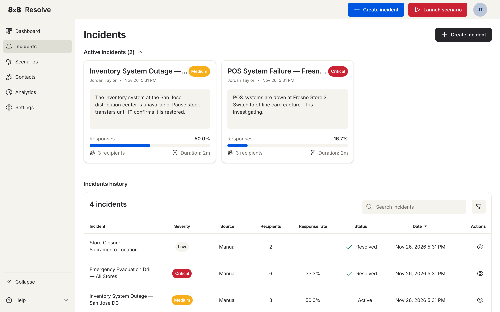
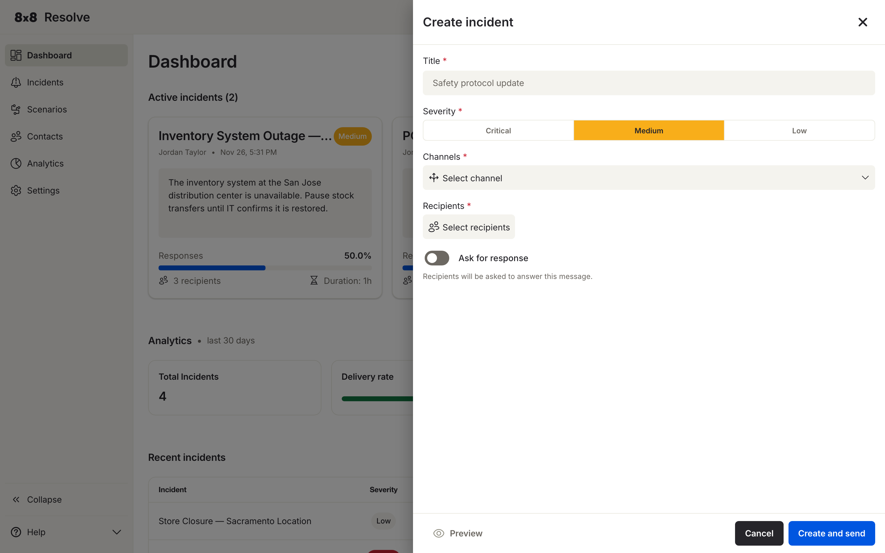
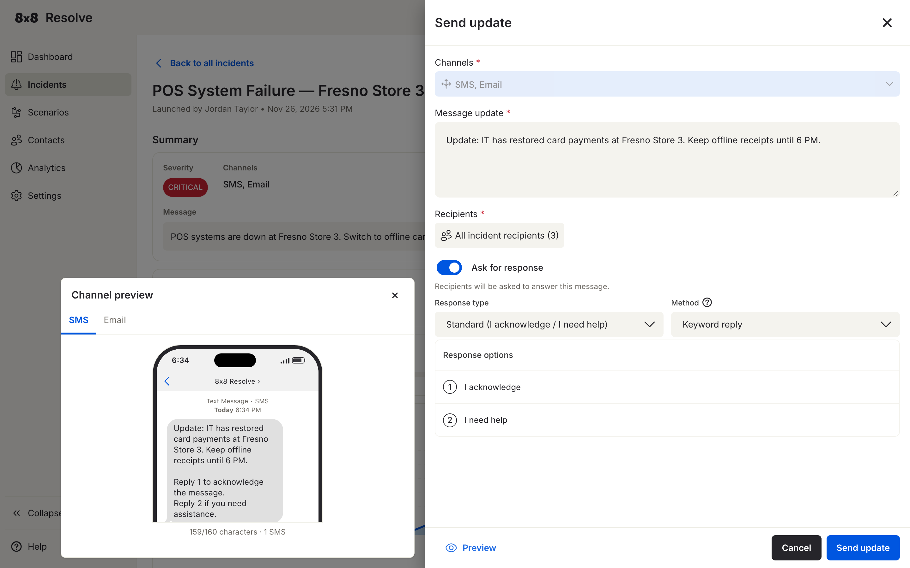
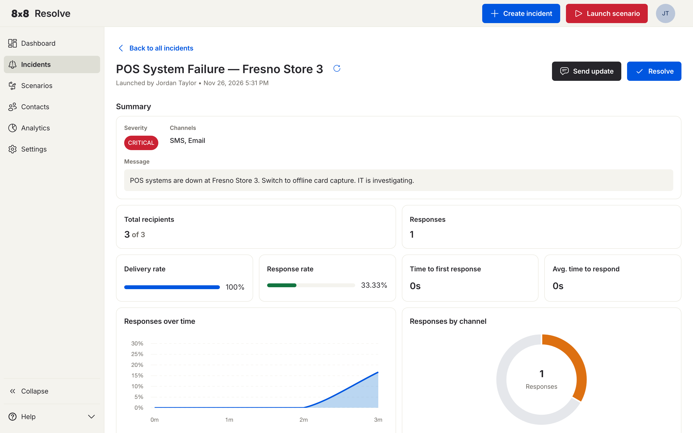
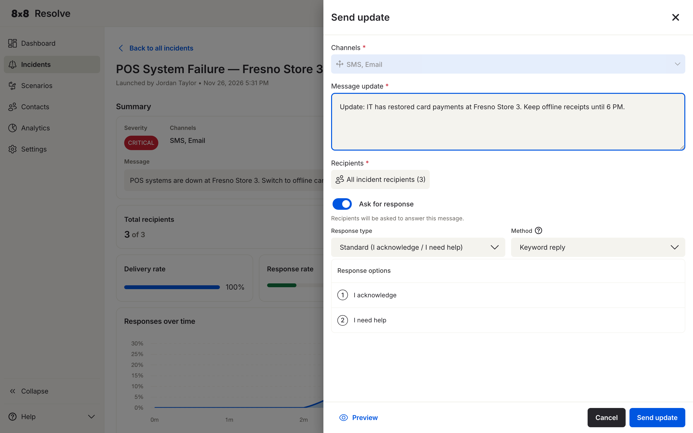
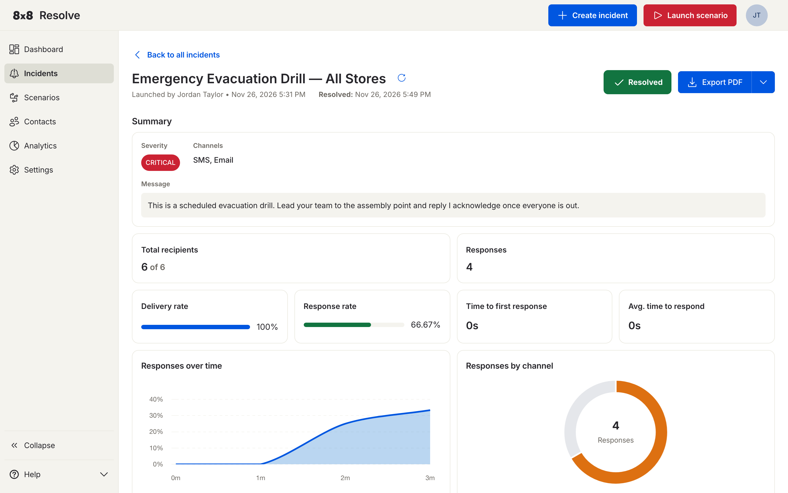

# Incidents

← [Back to Overview](./overview.md)

An incident is an alert you send to a group of recipients through one or more communication channels. You can create one at any time from the **Create incident** panel. To send alerts automatically, use a [Scenario](./scenarios.md).



## Create an incident

1. Click **+ Create incident** in the navigation bar. The **Create incident** panel opens on the right.
2. Fill in the incident details:

   | Field | Description |
   | --- | --- |
   | **Title** | A short name or summary of the incident (e.g., "Incidents test"). |
   | **Severity** | The incident's impact level — **Critical** (red), **Medium** (amber), or **Low**. This drives the visual indicators in the incident list. |
   | **Channels** | A multi-select of delivery channels — pick any combination (see [Delivery channels](#delivery-channels)). Selected channels appear as tags inline in the field. |
   | **Template** | A predefined message template. The message body auto-populates below the selector and is editable before sending; it supports variables such as `{{firstName}}`. Use the ✕ button to reset the selection. |
   | **WhatsApp Template** | A separate WhatsApp-specific template (used when WhatsApp is a selected channel), with an inline preview of the formatted message and any template buttons. If the template has dynamic fields, fill each one under **Map the dynamic fields** with a variable or your own text, and set a **Fallback if empty** value. You can't send until every field is mapped. Clear the template with the ✕ button. |
   | **Recipients** | Click **Select recipients** (the button shows a live count) to choose who receives the alert. See [Target specific recipients](#target-specific-recipients). |
   | **Ask for response** | Optional toggle to collect replies from recipients. See [Ask for response](#ask-for-response). |

3. Optionally, click **Preview** to check the message before you send it. See [Preview the message](#preview-the-message).
4. Click **Create and send** to dispatch the alert immediately, or **Cancel** to discard it.

> 📘 **Required fields**
>
> Fields marked with an asterisk (*) are required. If you click **Create and send** without filling them in, each empty field shows a red border and a "Field is required" message.



### Preview the message

Click **Preview** at the bottom of the panel to open **Channel preview**. It has a tab for each selected channel and shows the message as the recipient will see it, including the response instructions that Resolve adds — for example, *Reply 1 to acknowledge the message* for a keyword reply.

For SMS, the preview also shows the character count and how many SMS messages the text uses (for example, *159/160 characters · 1 SMS*). Longer messages are split into several SMS messages, and emoji or other special characters reduce how many characters fit in each one.



## Delivery channels

You can send an incident over any combination of these channels:

| Channel | How it reaches the recipient |
| --- | --- |
| **8x8 Work Messages** | Notification in the 8x8 Work desktop or web apps, delivered as a message. |
| **8x8 Work Mobile Notification** | High-priority push notification via the 8x8 Work / Resolve mobile app, delivered even when the app is in the background or the screen is locked. |
| **Email** | Email to their address. |
| **SMS** | Text message to their mobile number. |
| **Voice** | Automated text-to-voice call placed to their phone. |
| **WhatsApp** | Message to their WhatsApp number, sent using the selected **WhatsApp Template**. |

Selected channels are shown as tags inline within the **Channels** field. Choose **All channels** to select every channel, or pick any combination.

> 📘 **Each channel is sent independently**
>
> An incident sends on every selected channel at once. When a recipient responds on one channel, their other channels aren't stopped. To send on one channel and fall back to another only when there's no response, use a [Scenario](./scenarios.md).

## Target specific recipients

Click **Select recipients** to choose who receives the incident:

- **All recipients** — Send to every contact. You can then exclude individual people.
- **Specific people** — Search for and select contacts by name.
- **Filters** — Click **+ Add filter** and choose a contact attribute, such as **Department** (for example, Finance), **Location** (for example, New York Office), or **Role** (for example, Supervisor). Combine filters to narrow the list; the incident goes only to recipients who match all of them.

The button shows a live count of the selected recipients.

## Ask for response

Enable the **Ask for response** toggle to prompt recipients to reply to the incident. When it's on, three settings appear:

**Response type** — what kind of reply you're collecting:

| Type | Behaviour |
| --- | --- |
| **Standard** | Pre-set, read-only options: **I acknowledge** (keyword `1`) and **I need help** (keyword `2`). |
| **Custom poll** | Define your own options — up to five label/keyword pairs. Add them with **+ Add option**, delete any individually, and use **Preview** to check how they'll look. |

**Method** — how recipients submit their response:

| Method | How recipients respond |
| --- | --- |
| **Web link** | Recipients respond via a web-based link. |
| **Keyword reply** | Recipients respond by replying with the defined keyword (for example, over SMS). |

**Response options** displays the configured choices — the read-only *I acknowledge* / *I need help* for Standard, or your label/keyword pairs for a Custom poll. With **Keyword reply**, recipients answer a Standard response by replying `1` to acknowledge or `2` if they need help.

When a recipient sends a valid response, they get a confirmation that their response was recorded. Response links stay valid for as long as the incident is active.

> 📘 **WhatsApp-only incidents**
>
> **Ask for response** isn't available when WhatsApp is the only selected channel. Recipients respond with the buttons in the WhatsApp template instead, and those button taps count as responses.

You can track response rates in real time from the incident details page and the dashboard.

---

## Recipient response experience

When **Ask for response** is enabled, what the recipient sees depends on the **Method** chosen.

### Web link

The recipient receives a unique URL through their delivery channel. Opening it loads a hosted response page.

**Page layout:**

- **Header bar** (dark, full-width) — 8x8 Resolve brand mark.
- **Response card** (centred) — contains:

| Element | Description |
| --- | --- |
| **Severity pill** | Coloured pill showing severity in uppercase (e.g., **CRITICAL** in red, **MEDIUM** in amber). |
| **Relative timestamp** | Time since the incident was sent (e.g., *"0 minutes ago"*). Updates as time passes. |
| **Incident title** | Bold heading from the Create Incident panel. |
| **Message body** | The sent message with template variables resolved. |
| **Response buttons** | One full-width button per configured option (see below). |

**Standard response type** — two buttons:

- **Acknowledge** (blue, checkmark icon) — records an *I acknowledge* response.
- **I need help** (red, warning icon) — records an *I need help* response.

The buttons are mutually exclusive. Each recipient's URL is unique and tied to their identity — no login required. Responses feed into the incident's response tracking and are used by Condition nodes in scenarios.

**Custom poll** — one full-width button per configured option, in the order defined in the Create Incident panel.

### Keyword reply

The incident is delivered as plain text. The original message body is followed by one instruction line per configured response option:

```text
Reply {keyword} for {label}.
```

The recipient sends the keyword back as a regular reply on the same channel — no link or app required. Responses are attributed by sender phone number or WhatsApp ID. Any reply that doesn't match a configured keyword is treated as *Not responded*.

**Example (SMS with a custom poll):**

```text
This is a incidents sms test.

Reply Yes for Acknowledge.
Reply No for Need Help.
```

---

## Incidents page

Navigate to **Incidents** from the left menu to see all your past and active incidents.

### Active incident cards

The top of the page shows a card for each incident that's still active. Each card shows the title, severity, who launched it, a message preview, the response percentage, recipient count, and duration.

### Incidents history table

Below the cards, the **Incidents history** table lists your incidents with these columns:

| Column | Description |
| --- | --- |
| **Incident** | The incident title. |
| **Severity** | Critical, Medium, or Low. |
| **Source** | How the incident was created, for example **Manual** for an incident created from the **Create incident** panel. |
| **Recipients** | Number of people targeted. |
| **Response rate** | Percentage of recipients who responded. |
| **Status** | Active or Resolved. |
| **Date** | When the incident was created. |
| **Actions** | Open the incident details. |

> 📘 **Scenario alerts**
>
> Alerts sent by scenarios aren't listed in the Incidents history. To see what a scenario sent, open the scenario's runs from the [Scenarios](./scenarios.md) page.

### Search, filter, and sort

- **Search** — Type a keyword in **Search incidents** to filter the table instantly.
- **Date range** — Show only incidents from a selected period.
- **Severity** — Filter by Critical, Medium, or Low.
- **Source** — Filter by Manual or System.
- **Status** — Filter by Active or Resolved.

Combine as many filters as you need, then click **Apply**. To start fresh, click **Reset** — this clears all filters and restores the full list.

> 📘 **Filter persistence**
>
> Your active filters stay in place when you open an incident and come back. You won't lose your filter state just by navigating away.

### Incident details

Click an incident, on its card or in the **Incidents history** table, to open its details page. The header shows the title, who launched it and when, and a refresh icon that reloads the latest figures. While the incident is active, the header also has **Send update** and **Resolve**.

The page shows:

- **Summary** — The severity, the channels the incident was sent on, and the message.
- **Total recipients** and **Responses** — How many people the incident targeted and how many have responded.
- **Delivery rate**, **Response rate**, **Time to first response**, and **Avg. time to respond** — How well the incident is reaching people and how fast they're responding.
- **Responses over time** and **Responses by channel** — Charts of when responses came in and which channels they came from.
- The recipient list and the **Communications timeline** of every update, further down the page.



### Send an update

While an incident is active, you can send a follow-up to its recipients — for example, when the situation changes or the issue is fixed.

1. Open the incident and click **Send update**. The **Send update** panel opens with the incident's channels, recipients, and response settings already filled in.
2. Enter the **Message update**.
3. Optionally, change the **Channels** or the **Recipients**. By default, the update goes to **All incident recipients**.
4. Optionally, turn **Ask for response** on or off and change the **Response type** and **Method**. Each update can ask for its own response.
5. Click **Preview** to check the message on each channel, then click **Send update**.

The update appears in the incident's **Communications timeline**, and responses to it are tracked on the incident details page.



### Resolve an incident

Open an incident and click **Resolve**. The status in the history table updates to **Resolved** straight away, and the incident details page shows when it was resolved. The page shows the full picture — delivery and response metrics, the recipient list, and a communications timeline of every update through to resolution.



### Export an incident

Once an incident is resolved, click **Export PDF** on its details page to download a report. To download the data instead, click the arrow next to the button and choose **Export CSV**.
