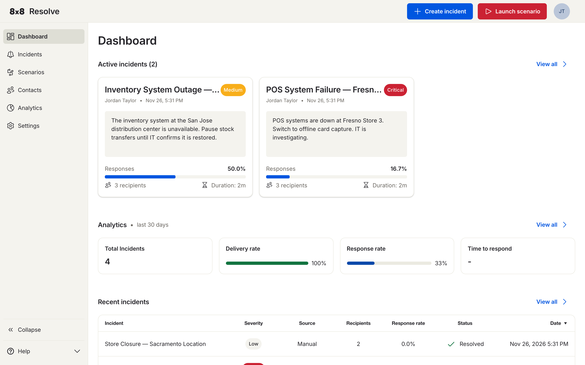

# 8x8 Resolve

8x8 Resolve is a critical communications platform that helps your organisation reach the right people instantly during an incident. Send targeted alerts across 8x8 Work, mobile push, email, SMS, voice, and WhatsApp — then track who responded and who needs help, all in real time.

> 📘 **8x8 Resolve is in beta**
>
> The free beta includes 8x8 Work Mobile push notifications, 8x8 Work Messages, and email. SMS, voice, and WhatsApp aren't part of the free beta. Pages that describe these channels apply only if your organisation has them enabled.

## What you can do

- **Create and send incidents** — Dispatch an alert to your entire organisation or a specific group in seconds.
- **Automate workflows** — Build scenarios that trigger on a schedule, a webhook, or an inbound message, branch on responses, and escalate automatically.
- **Sync your contacts** — Keep your recipient list up to date by connecting 8x8 Contacts or your directory or HR system (Google Workspace, Microsoft Entra ID, Okta, or Workday).
- **Monitor delivery** — Track delivery rates, response rates, and response times from the dashboard.

## Who signs in

Only the administrators you invite sign in to 8x8 Resolve at `resolve.8x8.com`. The people you alert are contacts: they receive incidents on their channels and respond from there, without signing in.

For help, open **Help** in the left menu and choose **Contact support**.

## Get started

New to 8x8 Resolve? Click through the [quick tour](./quick-tour.mdx) to see each area and create an incident, or take the [analytics tour](./analytics-tour.mdx).

| Guide | What you'll learn |
| --- | --- |
| [Dashboard](./dashboard.md) | Navigate the home screen and read your key metrics. |
| [Incidents](./incidents.md) | Create an incident and send it across multiple channels. |
| [Scenarios](./scenarios.md) | Build automated alert workflows with triggers, actions, and conditions. |
| [Contacts](./contacts.md) | Add, search, and manage recipients, and connect an HR system via the Integrations tab. |
| [Analytics](./analytics.md) | Track delivery, response rates, and channel effectiveness over time. |
| [Settings](./settings.md) | Manage message templates, channels, and sender identities. |
