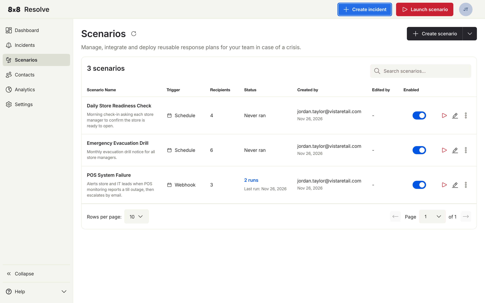
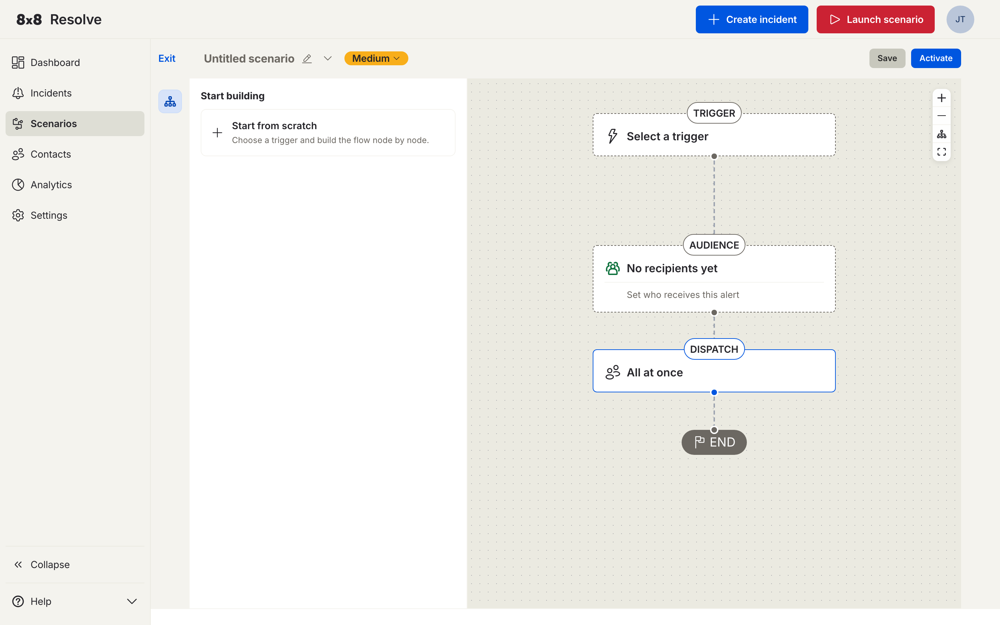
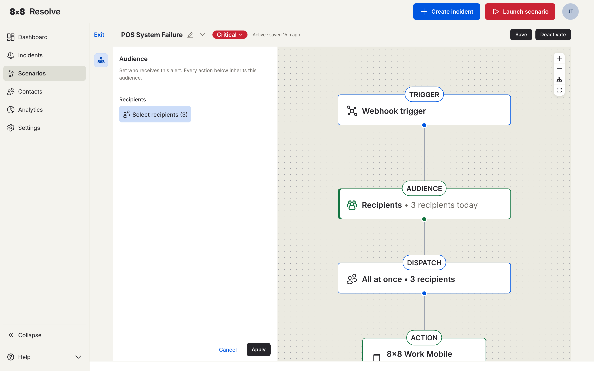
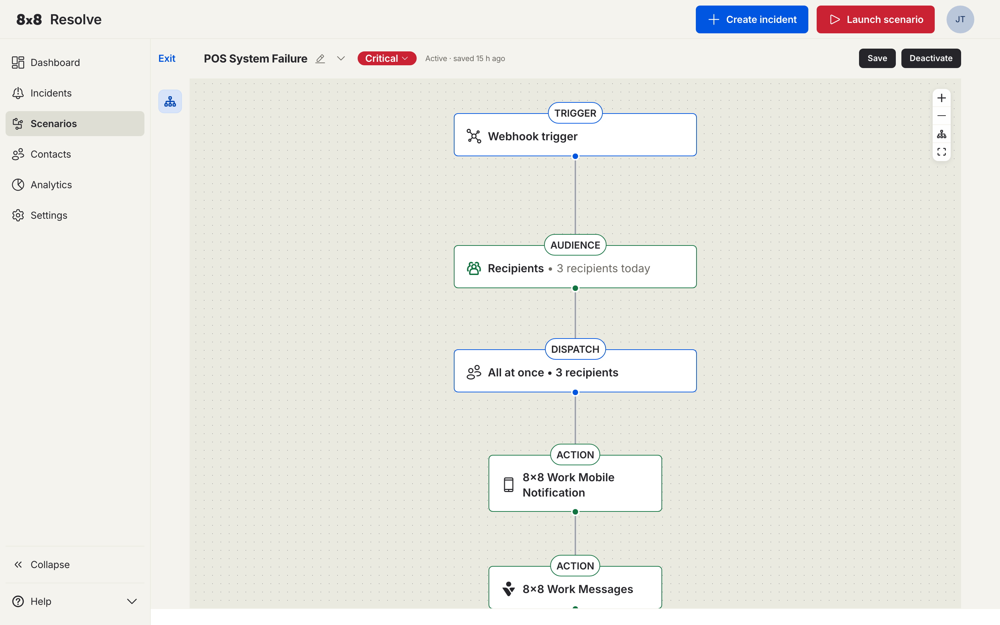
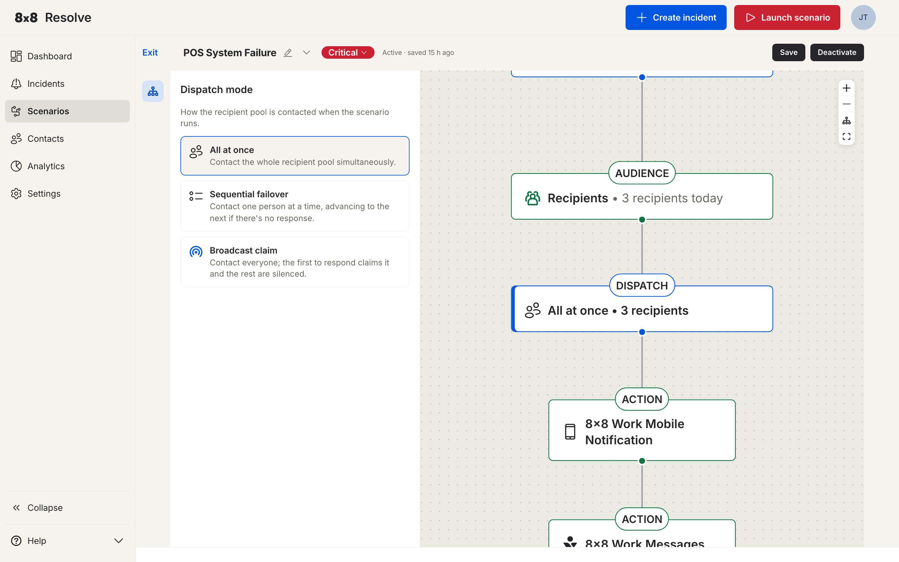
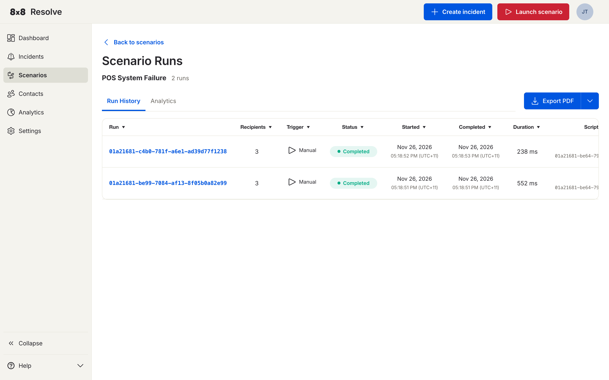
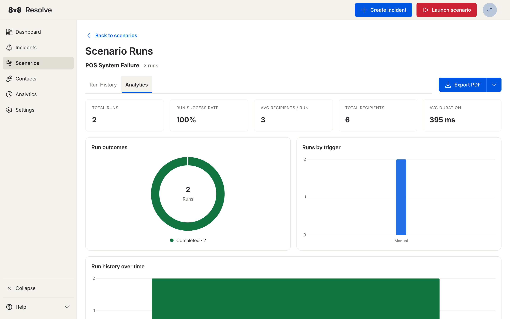

# Scenarios

← [Back to Overview](./overview.md)

Scenarios are pre-built alert workflows that run automatically on a trigger. A scenario can send messages across multiple channels, wait for acknowledgements, branch based on responses, and escalate — all without manual intervention.



## The Scenarios list

The **Scenarios** page lists every scenario you've created and is where you manage, launch, and build new ones. The header shows the total scenario count and a **search** box to find a scenario by name. From the top navigation you can also **+ Create incident** or **▷ Launch scenario** (run an existing scenario immediately).

Each row in the table shows:

| Column | Description |
| --- | --- |
| **Scenario Name** | The name, with a short description beneath. |
| **Trigger** | How the scenario fires: **Schedule**, **Webhook**, **Message** (SMS), or **WhatsApp**. |
| **Recipients** | Number of recipients targeted by default. |
| **Status** | Run history (for example, "2 runs · Last run: Nov 26, 2026"), or **Never ran**. Click the run count to open the scenario's runs. |
| **Created by** / **Edited by** | The user and date. |
| **Enabled** | Toggle to activate or disable the scenario. When off, the play and edit actions are greyed out. |

Per-row actions: **▷ Play** to launch immediately, **✏️ Edit** to open the scenario editor, and **⋮ More** for **Duplicate**, **Download**, or **Delete**.

> 📘 **Turning a scenario off**
>
> Turning off **Enabled** stops scheduled and inbound-message triggers, but a request to the scenario's webhook URL still starts a run. Changes you save to a scenario don't affect runs that are already in progress.

## Create a scenario

Click **+ Create scenario** (top right of the list) to open the scenario editor. To import a scenario file you downloaded earlier, click the arrow next to the button and choose **Upload scenario**.

The editor is a single page:

- **Header** — **Exit** returns to the Scenarios list. Click the name (**Untitled scenario** for a new scenario) to rename it, and use the severity chip to choose **Critical**, **Medium**, or **Low**. The severity applies to every alert the scenario sends. **Save** saves your changes, and **Activate** turns the scenario on.
- **Left panel** — Where you choose and configure what's selected on the canvas. A new scenario opens on **Start building**; choose **Start from scratch** to build the flow step by step.
- **Canvas** — The flow, from top to bottom: a **Trigger**, an **Audience**, a **Dispatch** step, the actions you add, and **End**. Use the controls in the top-right corner to zoom in, zoom out, tidy the layout, and expand the canvas.



## Building the workflow

1. **Choose a trigger.** Click **Select a trigger** on the canvas and pick one of the [triggers](#triggers) in the left panel, then configure it.
2. **Set the audience.** Click the **Audience** step and click **Select recipients** to choose who receives the scenario's alerts. Every action below the audience inherits it. Click **Apply**. The step then shows how many people it reaches today, for example *Recipients · 3 recipients today*.
3. **Choose a dispatch mode.** Click the **Dispatch** step to choose how the audience is contacted: everyone at once, one person at a time, or everyone until the first person claims the alert. See [Dispatch mode](#dispatch-mode). New scenarios start with **All at once**.
4. **Add actions.** Add the [actions](#actions) the scenario takes, such as sending an 8x8 Work Mobile Notification, and add [delays](#delays) and [conditions](#conditions) as needed.
5. **Save and activate.** Click **Save**, then **Activate**.



When you open an existing scenario, the header shows its status and when it was last saved (for example, *Active · saved 5 min ago*), and **Activate** becomes **Deactivate**.



---

## Triggers

Every scenario needs exactly one trigger. Currently supported:

### Scheduled time

Fires the scenario at a specific date and time.

| Option | Description |
| --- | --- |
| **Start date/time** | When the scenario first runs. |
| **Repeat** | Toggle on to repeat the trigger on a schedule. |
| **Repeat every** | How often to repeat — set a number and choose minutes, hours, weeks, or months. |
| **Repeat on** | For monthly schedules, choose a day of the month (for example, the 1st) or a weekday in the month (for example, the first Monday). |
| **End** | When to stop repeating: **Never**, **On a specific date**, or **After maximum repeats**. |

### Message received

Fires when an **SMS** arrives on a Resolve virtual number.

| Option | Description |
| --- | --- |
| **Keyword** | **Any** fires for any incoming message; **Specific** fires only for keywords you list (up to 50). |
| **Allowed sender numbers** | Restrict the trigger to specific numbers in E.164 format (up to 50). Leave empty to allow any sender. |
| **Trigger once per person** | When on, the scenario fires only once per unique sender. |
| **Trigger every** | Set a cooldown interval (e.g., every 24 hours) before the same sender can fire it again. |

### WhatsApp message received

Fires when a **WhatsApp** message arrives on a Resolve WhatsApp channel. It offers the same options as **Message received** — keyword filtering (Any/Specific), allowed sender numbers, trigger once per person, and a cooldown interval.

### Webhook received

Fires when an external system, such as a monitoring tool, sends a POST request to the scenario's webhook URL.

| Option | Description |
| --- | --- |
| **Webhook URL** | The endpoint to call. Copy it into the system that triggers the scenario. |
| **Bearer Token** | Required. Resolve generates a token for each scenario; use **Copy token** to copy it and **Regenerate token** to replace it. Regenerating stops the old token from working. |
| **Request body (optional)** | Map fields from the request's JSON body to variables that later steps can use. Add each **Mapping** as a source field (for example, `user.email`) and a target variable name. To start from an example, click **Use sample JSON** or drop a JSON file. |

The calling system sends the token in the `Authorization` header:

```http
POST <webhook URL>
Authorization: Bearer <token>
Content-Type: application/json

{ "store": "Fresno Store 3", "system": "POS" }
```

A request with a missing or wrong token is rejected with `401 Unauthorized`. Each token accepts up to one request per second.

If a webhook request arrives while the scenario is already running, the new run is queued and shows as **Queued** on the [Scenario Runs](#scenario-runs) page. Up to 256 runs can wait in the queue; after that, requests are rejected with `429` (**Trigger Queue Full**) until the queue drains. Scheduled and inbound-message triggers that fire while a run is in progress are skipped rather than queued.

---

## Dispatch mode

The **Dispatch** step sits below the audience and decides how the audience is contacted when the scenario runs. Click it, choose a mode, and click **Apply**. The step then shows the mode and the number of recipients, for example *All at once • 3 recipients*.

| Mode | How recipients are contacted | Best for |
| --- | --- | --- |
| **All at once** | Everyone in the audience is contacted at the same time. This is the default. | Alerts that everyone needs to see, such as an evacuation. |
| **Sequential failover** | One person at a time, in order. If the current person doesn't respond, the scenario moves on to the next person, until someone confirms. | On-call rotations and tiered escalation, where you want one owner at each step. |
| **Broadcast claim** | Everyone at the same time. The first person to respond claims the alert, and the notifications still pending for everyone else are cancelled. | Tasks that any one person in a group can handle, such as filling a shift or sending someone to a store. |



### Sequential failover

With **Sequential failover**, the scenario's actions run for one recipient at a time. How long Resolve waits before moving on to the next person is the **Timeout** you set on each message action's **Ask for response**, so turn on **Ask for response** for the actions in the flow.

#### Who's contacted first

You don't set the order by hand, and the order you pick people in the **Audience** step doesn't matter. Instead, Resolve spreads the work fairly: each scenario keeps its own history of who it has asked and who has confirmed, and every run starts with the person whose turn is longest overdue. **Next up** in the dispatch panel shows who's asked first on the next run.

When a run starts, Resolve:

1. Takes everyone in the audience at that moment. People added to the audience later join from the next run.
2. Puts first the people this scenario has never contacted, then everyone else, ordered by how long ago it was their turn — longest ago first. What counts as "their turn" depends on **When someone is skipped**:
   - **Keep their place** (default) — The last time they **confirmed**. Someone who was asked but didn't respond keeps their place near the front, so they're asked early again next time. Only confirming sends a person to the back.
   - **Pass their turn** — The last time they were **asked**, whether or not they confirmed. Anyone who was asked moves to the back.
3. Breaks ties (for example, on the scenario's first run, when nobody has any history) in a fixed internal order, which isn't alphabetical.

The order is fixed for the length of the run. Each person goes through the actions up to the condition that checks the dispatch outcome, and Resolve moves on to the next person when the current person's **Timeout** runs out or a message to them can't be delivered.

> 📘 **Example**
>
> The *Store Opening Cover* scenario reaches James Wilson, Maya Chen, and Chris Bradley. Suppose its first run asks James, who doesn't respond, then Maya, who confirms. Chris isn't asked.
>
> - With **Keep their place**, the next run asks James and Chris first, because neither has confirmed yet, and Maya last.
> - With **Pass their turn**, the next run asks Chris first (never asked), then James, then Maya.

If everyone in the list has been asked and nobody confirmed, the dispatch outcome is **Nobody confirmed**. If the **Nobody confirmed** branch of a later condition sends more messages, for example an SMS escalation, Resolve goes through the list again from the top with those actions.

To act on the result, add a [condition](#conditions) after the actions and check the dispatch **Outcome**: **Confirmed** or **Nobody confirmed**.

### Broadcast claim

With **Broadcast claim**, as soon as one person responds, the alert is theirs and the others stop receiving it. If nobody responds before the timeout, the step ends without a claim. A later [condition](#conditions) can branch on the **Claim status** (**claimed** or **timed out**) or on who claimed it.

---

## Actions

After the dispatch step, add one or more action nodes. Actions fall into two groups — **Notifications** and **Integrations**:

| Action | What it does |
| --- | --- |
| **8x8 Work Message** | Sends a message via 8x8 Work. |
| **8x8 Work Mobile Push Notification** | Sends a push notification through the 8x8 Work mobile app. |
| **Email** | Sends an email to the recipients. |
| **SMS** | Sends an SMS to the recipients' mobile numbers. |
| **Voice call** | Places an automated voice call to the recipients. |
| **WhatsApp message** | Sends a WhatsApp message through a Resolve WhatsApp channel. |
| **HTTP request** *(Integrations)* | Makes an outbound HTTPS request to an external system. |

For message actions you can also set:

- **Ask for response** — Toggle on to request a reply from recipients.
- **Timeout** — How long (in minutes or hours) to wait for a response before the workflow continues.

### HTTP request

Use an **HTTP request** action to call another system, for example to open a ticket in your service desk:

| Option | Description |
| --- | --- |
| **URL** | The endpoint to call. It must start with `https://` and can include [variables](#variables), such as `https://example.com/tickets/{{trigger.store}}`. |
| **Method** | **POST**, **GET**, **PUT**, **PATCH**, or **DELETE**. |
| **Headers** | Key and value pairs, such as an `Authorization` header for the other system. |
| **Request body (JSON)** | The JSON to send. It can include variables. |

The response's status code, body, and headers become the step's output. A later [condition](#conditions) can branch on them, for example to escalate when the call doesn't return `200`, and each run shows the response on the [Scenario Runs](#scenario-runs) page.

### Variables

Message text, HTTP request URLs, and request bodies can include variables. Type `{{` to open a list of the variables you can use at that point in the flow:

| Variable | Replaced with |
| --- | --- |
| Contact fields, such as `{{firstName}}` or `{{department}}` | The recipient's details. See [Placeholders](./templates.md#placeholders). |
| `{{trigger.<field>}}` | A field from the trigger — for a webhook, a variable you mapped from the request body. |
| Reply keyword / reply label | The keyword or label a recipient replied with in an earlier step. Choose the step from the `{{` list. |
| Earlier step outputs | For example, the status code or body of an earlier HTTP request. |
| `{{dispatch.<field>}}` | With **Sequential failover** or **Broadcast claim**, the dispatch result, such as the name of the person who confirmed. |

A variable that doesn't match anything is sent as literal text, so check spelling before you activate the scenario.

---

## Delays

Add a **Delay** node between steps to pause before the next action runs. Two modes are available:

| Mode | Description |
| --- | --- |
| **Specified period** | Wait for a fixed duration — set an amount and unit (minutes, hours, days, weeks, or months). |
| **Scheduled date** | Pause until a specific date and time before the workflow continues. |

---

## Conditions

Add a **Condition** node to branch the workflow based on the result of an earlier step.

- **Then** path — Followed when the condition is met.
- **Else** path — Followed when the condition is not met. Use this to escalate through a different channel.

The condition checks the output of an earlier step. For a message action, choose one or more values under **Where result**:

| Value | When it triggers |
| --- | --- |
| **Responded** | The recipient replied within the timeout window. |
| **Not responded (timeout)** | The timeout elapsed with no reply received. |
| **Failed to deliver** | The message could not be delivered to the recipient. |

With a [dispatch mode](#dispatch-mode) other than **All at once**, you can also check the dispatch result: the **Outcome** (**Confirmed** or **Nobody confirmed**), the **Claimant name**, or their **Reply** for **Sequential failover**, and the **Claim status** (**claimed** or **timed out**) for **Broadcast claim**.

You can also compare a variable or an HTTP response — for example, the reply keyword, a field from the webhook request, the HTTP status code, or a **Body path** in the response — using these operators: **is**, **is not**, **contains**, **does not contain**, **starts with**, **ends with**, **is empty**, and **is not empty**.

Conditions can be nested: add another Condition inside a **Then** or **Else** path to branch again.

> 📘 **Example**
>
> Send an email → wait 30 minutes → check if acknowledged.
> If **yes** → end the workflow.
> If **no** → send an SMS as a follow-up.

---

## Save and launch

Click **Save** in the editor header to save the scenario, and **Activate** to turn it on. Your scenario appears in the scenarios table with its name, trigger type, recipient count, and enabled/disabled status.

To run a scenario immediately without waiting for its scheduled trigger, click **Launch scenario** in the navigation bar and select the scenario you want to run.

Each run is listed on the scenario's [Scenario Runs](#scenario-runs) page.

---

## Scenario runs

Every time a scenario runs, Resolve records the run. To see a scenario's runs, click the run count (for example, **2 runs**) in the **Status** column of the Scenarios list.



The **Run History** tab lists each run:

| Column | Description |
| --- | --- |
| **Run** | The run ID. Click it to open the run's details. |
| **Recipients** | Number of people the run reached out to. |
| **Trigger** | What started the run, such as **Manual**, **Scheduled**, or **Webhook**. |
| **Status** | **Completed**, **Failed**, **In progress**, or **Queued**. |
| **Started** / **Completed** | When the run began and finished. |
| **Duration** | How long the run took. |
| **Script Version** | The version of the scenario that ran. |

The **Analytics** tab summarises the scenario's runs: **Total runs**, **Run success rate**, **Avg recipients / run**, **Total recipients**, and **Avg duration**, with **Run outcomes**, **Runs by trigger**, and **Run history over time** charts.



Click **Export PDF** to download the runs as a report, or click the arrow next to it and choose CSV for the data. A CSV export is emailed to you when it's ready.

### Run details

Click a run ID to open **Run ID Details**. It shows:

- A read-only view of the flow as it ran. Click a step to see its configuration and how many recipients went through it.
- An **Overview** of the run: status, trigger, start and end times, duration, and how many recipients were **Reached**, **Unreachable**, and **Responded**.
- A list of recipients. Filter it by status or channel, and expand a recipient to see each send on each channel and its delivery history — including the response to an HTTP request.

Click **Export .csv** to download the run's details.
