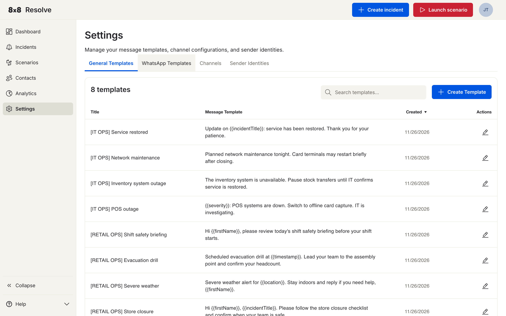
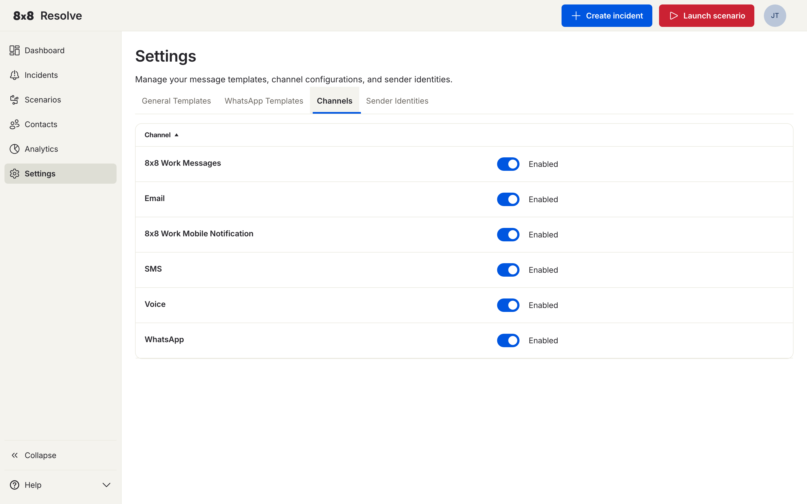
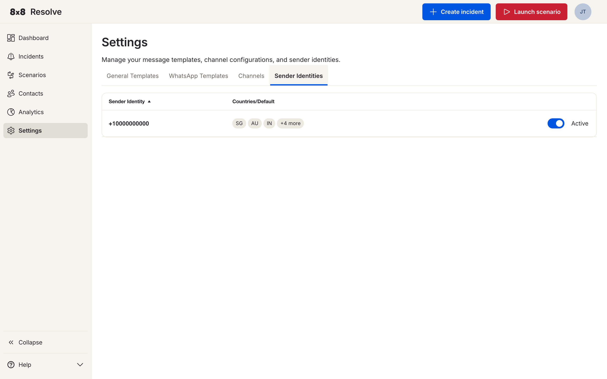

# Settings

← [Back to Overview](./overview.md)

**Settings** is where you manage your message templates, channel configurations, and sender identities. Open it from **Settings** in the left navigation.

Settings is organised into tabs:

| Tab | What it's for |
| --- | --- |
| **General Templates** | Reusable message templates with dynamic placeholders. See [Templates](./templates.md). |
| **WhatsApp Templates** | The WhatsApp templates available to your organisation, selected when WhatsApp is a delivery channel on an incident. |
| **Channels** | Turn the delivery channels available to your organisation on or off. |
| **Sender Identities** | See the sender IDs and numbers your messages are sent from. |

## General Templates

The **General Templates** tab manages reusable message templates — give a template a name and message, drop in placeholders such as `{{firstName}}`, and reuse it when creating incidents and scenarios. For the full workflow, placeholders, and validation rules, see the [Templates](./templates.md) page.

## WhatsApp Templates

WhatsApp requires pre-registered message templates. The **WhatsApp Templates** tab lists the templates available to your organisation, with these columns:

| Column | Description |
| --- | --- |
| **Name** | The template name. |
| **Message** | The template text. |
| **Status** | Whether WhatsApp has approved the template: **Approved**, **Pending**, **Rejected**, or **Pending deletion**. |
| **Created** | When the template was created. |

The list is read-only: WhatsApp templates are created and registered in 8x8 Connect, not in Resolve. You pick an approved template in the **WhatsApp Template** field of the [Create incident panel](./incidents.md#create-an-incident) when WhatsApp is a selected channel.

## Channels

The **Channels** tab lists the delivery channels set up for your organisation, such as 8x8 Work Messages, 8x8 Work Mobile Notification, and Email. Use the toggle next to each channel to turn it on (**Enabled**) or off.

8x8 sets up your channels and their names. To add a channel, contact 8x8 support from **Help → Contact support**.

## Sender Identities

The **Sender Identities** tab lists the sender IDs and phone numbers that outbound SMS and voice messages are sent from:

| Column | Description |
| --- | --- |
| **Sender Identity** | The sender ID or phone number. |
| **Countries/Default** | The countries the sender identity is used for, or whether it's the default. |
| Toggle | Whether the sender identity is **Active**. |

Email doesn't need a sender identity. 8x8 sets up your sender identities; to add one, contact 8x8 support from **Help → Contact support**.

